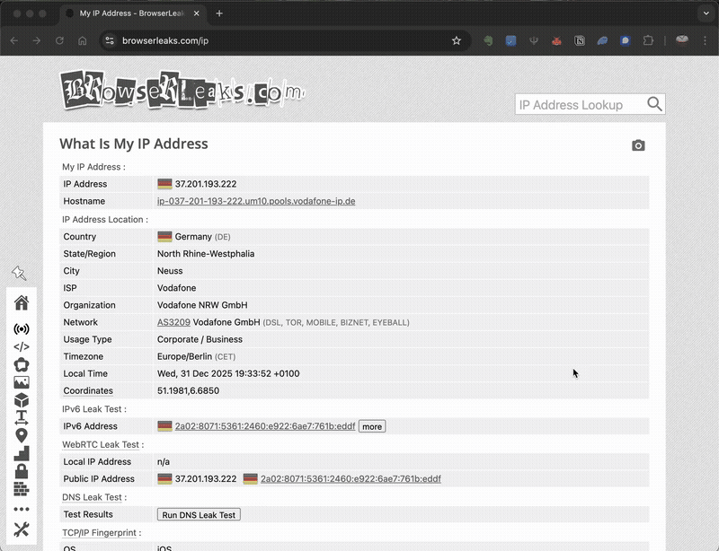

# region-proxy

[](https://github.com/M-Igashi/region-proxy/actions/workflows/ci.yml)
[](https://github.com/M-Igashi/region-proxy/releases)
[](https://github.com/M-Igashi/region-proxy/releases/latest)
[](https://opensource.org/licenses/MIT)

A CLI tool to create a SOCKS proxy through AWS EC2 in any region.

<p align="center">
  
</p>

## Quick Start

```bash
# 1. Install
brew tap M-Igashi/tap
brew install region-proxy

# 2. Set your default region (one-time setup)
region-proxy config set-region ap-northeast-1

# 3. Start the proxy
region-proxy start

# 4. Verify your IP is now in Tokyo
curl ipinfo.io

# 5. Stop when done
region-proxy stop
```

That's it! After the initial setup, just run `region-proxy start` and `region-proxy stop`.

## Features

- **Multi-region support** – Launch a proxy in any of 17 AWS regions
- **One command setup** – Automatically handles EC2 instance, security groups, and SSH keys
- **Configurable defaults** – Set default region, port, and other preferences
- **Secure** – Uses SSH dynamic port forwarding (SOCKS5 proxy)
- **macOS integration** – Automatically configures system-wide SOCKS proxy
- **Clean shutdown** – Automatically terminates EC2 instance and cleans up all AWS resources
- **Cost-effective** – Uses the smallest instance types (t4g.nano/t3.nano, ~$0.004/hour)

## Prerequisites

- macOS
- AWS account with the IAM permissions listed in [AWS Setup](#aws-setup)
- AWS CLI configured (`aws configure`)

## Installation

### Homebrew (Recommended)

```bash
brew tap M-Igashi/tap
brew install region-proxy
```

### From Source

```bash
git clone https://github.com/M-Igashi/region-proxy.git
cd region-proxy
cargo install --path .
```

## Usage

### Start a proxy

```bash
region-proxy start                              # Use default region
region-proxy start --region us-west-2           # Specify region
region-proxy start --port 8080                  # Custom port
region-proxy start --no-system-proxy            # Don't configure system proxy
```

### Check status

```bash
region-proxy status
```

### Stop the proxy

```bash
region-proxy stop
region-proxy stop --force    # Continue even if some cleanup fails
```

### List available regions

```bash
region-proxy list-regions
region-proxy list-regions --detailed
```

### Configuration

```bash
region-proxy config show                        # Show current config
region-proxy config set-region ap-northeast-1   # Set default region
region-proxy config set-port 8080               # Set default port
region-proxy config reset                       # Reset all settings
```

### Cleanup orphaned resources

```bash
region-proxy cleanup
region-proxy cleanup --region ap-northeast-1
```

## AWS Setup

### Option 1: Terraform (Recommended)

```bash
cd terraform
terraform init
terraform apply

# Configure AWS CLI with the created credentials
aws configure
# Enter the access_key_id and secret_access_key from terraform output
terraform output -raw secret_access_key
```

### Option 2: CloudFormation

```bash
aws cloudformation create-stack \
  --stack-name region-proxy-iam \
  --template-body file://cloudformation/region-proxy-iam.yaml \
  --capabilities CAPABILITY_NAMED_IAM

# Wait for stack creation
aws cloudformation wait stack-create-complete --stack-name region-proxy-iam

# Get credentials
aws cloudformation describe-stacks --stack-name region-proxy-iam \
  --query 'Stacks[0].Outputs'

# Configure AWS CLI with the credentials
aws configure
```

### Option 3: Manual Setup

Create an IAM policy with the following permissions:

```json
{
    "Version": "2012-10-17",
    "Statement": [
        {
            "Effect": "Allow",
            "Action": [
                "ec2:DescribeInstances",
                "ec2:DescribeSecurityGroups",
                "ec2:DescribeKeyPairs",
                "ec2:RunInstances",
                "ec2:TerminateInstances",
                "ec2:CreateSecurityGroup",
                "ec2:DeleteSecurityGroup",
                "ec2:AuthorizeSecurityGroupIngress",
                "ec2:CreateKeyPair",
                "ec2:DeleteKeyPair",
                "ec2:CreateTags"
            ],
            "Resource": "*"
        },
        {
            "Effect": "Allow",
            "Action": "ssm:GetParameters",
            "Resource": "arn:aws:ssm:*::parameter/aws/service/ami-amazon-linux-latest/*"
        }
    ]
}
```

`ssm:GetParameters` is limited to the AWS public parameters that point to the latest Amazon Linux AMIs. EC2 reads them when launching the instance.

Then configure AWS CLI:

```bash
aws configure
```

### Upgrading from v1.3.0 or earlier

Since v2.0.0, region-proxy looks up the AMI through an AWS public SSM parameter instead of `ec2:DescribeImages`, so the IAM policy needs `ssm:GetParameters`. Without it, `region-proxy start` fails with `SsmAccessDenied` and no instance is launched. Update the policy you created:

```bash
# Terraform
cd terraform
terraform apply

# CloudFormation (keep the existing parameter values, otherwise the IAM user is recreated with defaults)
aws cloudformation update-stack \
  --stack-name region-proxy-iam \
  --template-body file://cloudformation/region-proxy-iam.yaml \
  --capabilities CAPABILITY_NAMED_IAM \
  --parameters ParameterKey=UserName,UsePreviousValue=true ParameterKey=CreateAccessKey,UsePreviousValue=true
aws cloudformation wait stack-update-complete --stack-name region-proxy-iam
```

For a manually created policy, add the `ssm:GetParameters` statement shown above. The access key and the IAM user stay the same in all three cases. The updated policy no longer includes `ec2:DescribeImages`, which v1.3.0 and earlier need, so upgrade the CLI (`brew upgrade region-proxy`) at the same time.

## How it works

1. Creates a temporary security group allowing SSH access
2. Generates a temporary SSH key pair
3. Launches a minimal EC2 instance (t4g.nano) with the latest Amazon Linux 2023 AMI, resolved by EC2 from the AWS public SSM parameter
4. Establishes an SSH tunnel with dynamic port forwarding
5. Optionally configures macOS system proxy

When you stop the proxy, all resources are automatically cleaned up.

## Troubleshooting

**AuthFailure or credential errors**

```bash
aws sts get-caller-identity
```

**SsmAccessDenied / not authorized to perform ssm:GetParameters**

The IAM policy predates v2.0.0. See [Upgrading from v1.3.0 or earlier](#upgrading-from-v130-or-earlier).

**No region specified**

```bash
region-proxy config set-region ap-northeast-1
```

**Orphaned resources**

```bash
region-proxy cleanup
```

## License

MIT License - see [LICENSE](LICENSE) for details.
